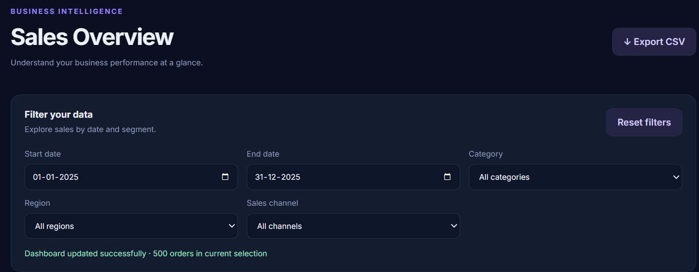
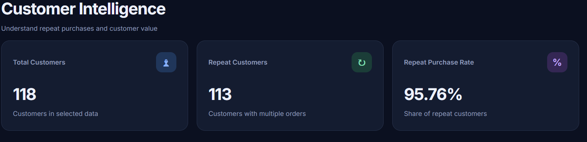
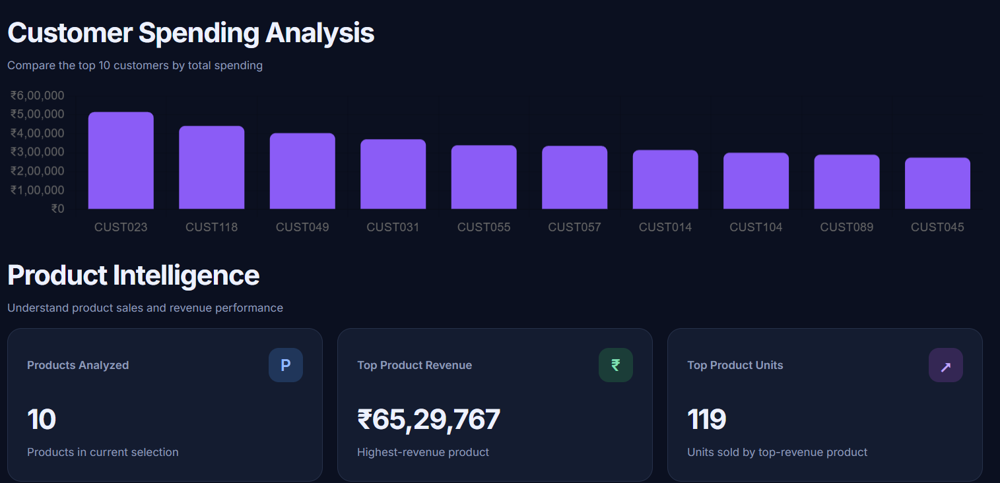
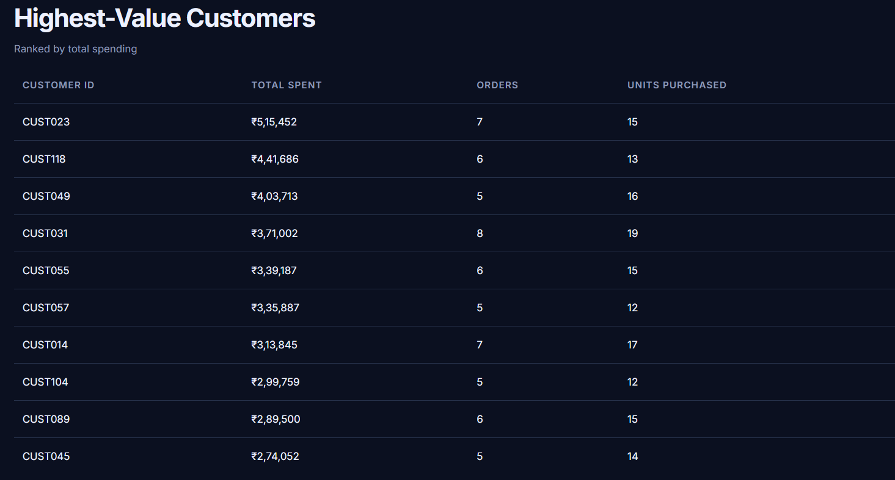
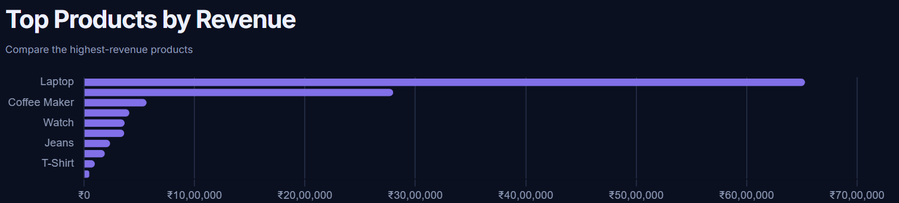
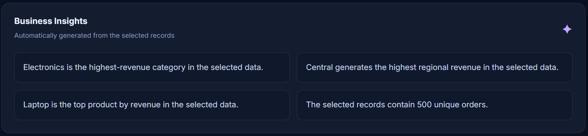

# Shoplytics — E-commerce Sales & Customer Insights

A data analytics dashboard built with Python, Flask, Pandas, HTML, CSS, JavaScript, and Chart.js to explore e-commerce sales performance, customer behavior, and product revenue.

## Dashboard Preview

### Sales Overview


### Customer Intelligence


### Customer Spending Analysis


### Highest-Value Customers


### Product Performance


### Business Insights


## Project Overview

Shoplytics transforms e-commerce order data into interactive dashboards and business insights. Users can filter data, compare sales performance, analyze customers, explore product revenue, and export filtered records.

**Note:** This project uses synthetic/sample data for demonstration and portfolio purposes.

## Features

- **Sales Analytics:** Revenue, orders, units sold, unique customers, and average order value.
- **Interactive Filters:** Filter results by category, region, sales channel, and date range.
- **Sales Trends:** Visualize revenue and order trends over time.
- **Category & Region Analysis:** Compare revenue across product categories and regions.
- **Customer Intelligence:** Analyze repeat customers, repeat-purchase rate, and highest-value customers.
- **Product Intelligence:** Compare products by revenue and units sold.
- **Business Insights:** Display insights based on the selected data.
- **CSV Export:** Download filtered data for further analysis.
- **Responsive Dashboard:** View analytics through a web-based interface.

## Tech Stack

| Technology | Purpose |
|---|---|
| Python | Backend programming and data processing |
| Flask | Web application and API endpoints |
| Pandas | Data analysis and aggregation |
| HTML | Dashboard structure |
| CSS | Styling and layout |
| JavaScript | Interactive functionality |
| Chart.js | Data visualization |

## Project Structure

```text
Ecommerce_Sales_Customer_Insights/
├── app.py
├── check_data.py
├── requirements.txt
├── README.md
├── .gitignore
├── data/
│   ├── generate_data.py
│   └── sales_data.csv
├── templates/
│   └── index.html
└── static/
    ├── style.css
    ├── script.js
    └── favicon.svg
```

The local virtual environment should not be committed to GitHub.

## Installation and Setup

### 1. Clone the repository

```bash
git clone YOUR_GITHUB_REPOSITORY_URL
cd Ecommerce_Sales_Customer_Insights
```

Replace `YOUR_GITHUB_REPOSITORY_URL` with your actual repository URL.

### 2. Create a virtual environment

```bash
python -m venv virtual
```

### 3. Activate the environment

**Windows PowerShell:**

```powershell
.\virtual\Scripts\Activate.ps1
```

### 4. Install dependencies

```bash
pip install -r requirements.txt
```

### 5. Run the application

```bash
python app.py
```

Open this address in your browser:

```text
http://127.0.0.1:5000
```

## Example Use Cases

- Identify products generating the highest revenue.
- Compare sales across regions and categories.
- Monitor changes in revenue and order volume.
- Identify high-value and repeat customers.
- Export filtered data for additional analysis.

## Learning Outcomes

This project demonstrates practical skills in data cleaning and aggregation, REST-style API development, interactive dashboard design, data visualization, and Git-based project management.

## Future Improvements

- Add customer segmentation.
- Introduce forecasting for sales trends.
- Add more advanced business recommendations.
- Deploy the dashboard online.
- Add automated tests and improve error handling.

## Author

Developed as an e-commerce analytics and data science portfolio project.
